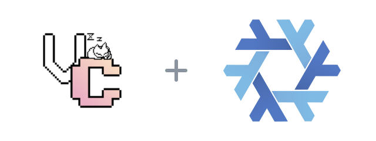

<p align="center">
  
</p>

<h1 align="center">vencord-flake</h1>

<p align="center">
  <a href="flake.nix"></a>
  <a href="LICENSE"></a>
</p>

[Vencord](https://vencord.dev) is a client mod for Discord. Its own plugins can only be added by building it from source.

This flake does that build for NixOS: it takes Vencord from nixpkgs, adds every plugin under [`plugins/`](plugins), and patches the result into the Discord package. It is for people who want their own Vencord plugins without keeping a checkout to rebuild by hand.

```sh
nix run github:Fractal-Tess/vencord-flake
```

Discord runs on x86_64 Linux. The custom Vencord bundle also builds on ARM64 Linux, where upstream Discord has no native application. Both outputs are checked on native GitHub runners.

## Install on NixOS

```nix
inputs.vencord-flake = {
  url = "github:Fractal-Tess/vencord-flake";
  inputs.nixpkgs.follows = "nixpkgs";
};
```

```nix
{
  imports = [ inputs.vencord-flake.nixosModules.default ];

  programs.discord-vencord.enable = true;
}
```

This replaces `pkgs.discord`, so a host that already installs Discord gets the patched one. Discord is unfree and must be allowed on the host.

## Plugins

| Plugin | What it does |
| --- | --- |
| [HyperTrader](plugins/hyperTrader) | Forwards new messages from chosen channels to an HTTP endpoint. It only reads. |

To add one, put its folder in `plugins/` and rebuild. Turn plugins on in Discord under Settings > Vencord > Plugins.

Client mods are against Discord's terms of service. Use this on your own account at your own risk.

## Credits

The logo places the [Vencord icon](https://github.com/Vendicated/Vencord/blob/main/browser/icon.png) (GPL-3.0-or-later) beside the [Nix snowflake](https://github.com/NixOS/nixos-artwork/tree/master/logo) (CC BY 4.0), both resized and otherwise unchanged. This project is not affiliated with either.
